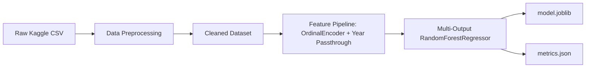

<div align="center">

# PLAYNEX

**Game Market Intelligence & Launch Strategy Platform**

*Build smarter. Launch strategically.*

[](https://react.dev/)
[](https://www.typescriptlang.org/)
[](https://vitejs.dev/)
[](https://tailwindcss.com/)
[](https://www.python.org/)
[](https://flask.palletsprojects.com/)
[](https://scikit-learn.org/)

[Features](#features) • [Architecture](#architecture) • [Machine Learning Pipeline](#machine-learning-pipeline) • [Quickstart](#quickstart) • [Deployment](#deployment) • [Limitations](#limitations)

</div>

---

## Overview

**PLAYNEX** is a data-driven launch strategy platform designed for indie game developers, game studios, and small publishers. By analyzing historical game sales records (1980–2016) with a multi-output **Random Forest Regression** model, PLAYNEX transforms raw video game market history into actionable pre-launch intelligence:

- **Market Research**: Uncover historical genre distributions, console generation dynamics, and regional preferences across North America, Europe, Japan, and other markets.
- **Competitor Benchmarking**: Search, filter, and inspect thousands of historical releases with multi-game side-by-side metric comparisons.
- **Launch Simulator**: Configure hypothetical games by target genre, platform, publisher, and release timeframe to predict regional and worldwide unit sales.
- **Evidence-Based Recommendations**: Generate platform-genre fit ratings, identify high-opportunity markets, and discover top-performing comparable titles.

> [!NOTE]
> PLAYNEX uses historical dataset patterns (1980–2016) to assist pre-production planning. It is designed as a decision-support platform, not an absolute guarantee of commercial success.

---

## Features

### 1. Market Intelligence
- **Genre Dynamics**: Interactive sales breakdowns across all major historical genres.
- **Platform Comparisons**: Head-to-head performance across 30+ console generations and handhelds.
- **Regional Demand**: Distribution charts highlighting market share across NA, EU, JP, and ROW.
- **Sales Trendline**: Multi-decade historical release patterns and revenue shifts over time.
- **Dynamic Insights**: Automated data-driven findings summarizing top platforms and market conditions based on active filters.

### 2. Competitor Intelligence
- Search across 16,000+ historical titles by title, publisher, platform, genre, and release period.
- Sort by Global Sales, North American Sales, Critic Score, and Release Year.
- Select up to 5 games for side-by-side comparisons covering sales metrics, regional distribution, and review scores.

### 3. Launch Simulator (Centrepiece)
- Configure target parameters: **Genre**, **Platform**, **Publisher**, and **Release Year Reference**.
- Inputs are strictly constrained to verified historical categories, eliminating invalid prediction inputs.
- Single multi-output **Random Forest Regressor** predicts:
  - North American Sales (`NA_Sales`)
  - European Sales (`EU_Sales`)
  - Japanese Sales (`JP_Sales`)
  - Other Regional Sales (`Other_Sales`)
  - Global Sales (`Global_Sales`)
- **Strategy Comparison**: Save multiple scenarios (e.g., PS3 vs. Xbox 360 vs. PC launch) and inspect variance tables to identify the historically optimal configuration.

### 4. Launch Recommendations
- Ranked genre-platform combinations by historical average sales.
- Regional demand concentration for selected game genres.
- Top comparable titles and alternative platforms worth investigating with minimum historical sample thresholds.

### 5. Model Transparency & Evaluation
- Real-time reporting of actual test split results ($R^2$, MAE, RMSE) computed on a held-out 20% test dataset.
- Direct benchmark against a mean-prediction baseline (`DummyRegressor`).
- Feature importance visualization displaying relative weights for Genre, Platform, Publisher, and Release Year.

---

## Architecture

PLAYNEX is built with a decoupled frontend and API architecture:

```
playnex/
├── backend/                  # Flask REST API
│   ├── routes/               # Modular API route blueprints
│   │   ├── health.py         # Health checks
│   │   ├── overview.py       # Aggregate dataset metrics
│   │   ├── market.py         # Market analysis & filters
│   │   ├── games.py          # Paginated search & comparisons
│   │   ├── simulator.py      # RF sales inference & scenario comparisons
│   │   ├── recommendations.py# Evidence-backed strategy suggestions
│   │   └── model_metrics.py  # Model evaluation metrics & feature weights
│   ├── services/
│   │   └── data_service.py   # Cached singleton for dataset operations
│   ├── app.py                # WSGI entrypoint with CORS
│   └── requirements.txt      # Backend Python dependencies
├── ml/                       # Machine learning pipeline
│   ├── preprocessing.py      # Cleaning, deduplication, imputation
│   ├── train.py              # Multi-output Random Forest training & evaluation
│   └── predict.py            # Prediction service & input validation
├── frontend/                 # React 19 + TypeScript + Vite application
│   ├── src/
│   │   ├── components/       # Metric cards, sidebar, error/skeleton states
│   │   ├── pages/            # Overview, Market, Competitors, Simulator, Recs, Model
│   │   ├── services/         # Axios API client (VITE_API_BASE compatible)
│   │   └── index.css         # shadcn-inspired neutral monochrome styling
│   └── package.json
├── data/
│   ├── raw/                  # Source CSV location
│   └── processed/            # Preprocessed dataset & stats cache
└── artifacts/                # Trained model pipeline & metrics JSON
```

---

## Machine Learning Pipeline



### Pre-Launch Features Only (Zero Target Leakage)
To prevent target leakage, post-release metrics are strictly excluded from prediction features:
- **Included**: `Genre`, `Platform`, `Publisher`, `Year`
- **Excluded**: `Critic_Score`, `User_Score`, `Critic_Count`, `User_Count`, and regional sales numbers.

### Model Evaluation (Held-Out 20% Test Split)

| Target | Random Forest $R^2$ | Baseline $R^2$ | Random Forest MAE | Random Forest RMSE |
|---|---|---|---|---|
| **NA Sales** | `0.0534` | `-0.0002` | `0.2736M` | `0.9887M` |
| **EU Sales** | `0.0475` | `-0.0005` | `0.1763M` | `0.6804M` |
| **JP Sales** | `0.2178` | `-0.0001` | `0.0826M` | `0.2734M` |
| **Other Sales** | `0.0745` | `-0.0003` | `0.0528M` | `0.1996M` |
| **Global Sales** | `0.0648` | `-0.0003` | `0.5362M` | `1.9653M` |

*Evaluation results are computed on 3,344 unseen test titles ($N_{train} = 13,373$, random seed = 42).*

---

## Quickstart

### Prerequisites
- Python 3.10 or higher
- Node.js 18 or higher with npm

### 1. Clone the Repository
```bash
git clone https://github.com/Debug-100/playnex.git
cd playnex
```

### 2. Set Up the Backend
```bash
# Create virtual environment (optional but recommended)
python -m venv venv
venv\Scripts\activate  # Windows
# source venv/bin/activate  # macOS / Linux

# Install dependencies
pip install -r backend/requirements.txt
```

### 3. (Optional) Run Dataset Preprocessing & Training
> [!TIP]
> Pre-trained model artifacts (`artifacts/model.joblib`) and processed data are already included in the repository. You can skip this step unless you wish to rebuild the model from scratch.

If retraining from raw data:
1. Download [Video Games Sales with Ratings](https://www.kaggle.com/datasets/rush4ratio/video-game-sales-with-ratings) from Kaggle.
2. Save it to `data/raw/Video_Games_Sales_as_at_22_Dec_2016.csv`.
3. Run:
```bash
python ml/preprocessing.py
python ml/train.py
```

### 4. Run the Servers

#### Terminal 1 — Backend:
```bash
cd backend
python app.py
```
*API runs at `http://localhost:5000` (Health check: `http://localhost:5000/api/health`)*

#### Terminal 2 — Frontend:
```bash
cd frontend
npm install
npm run dev
```
*Application runs at `http://localhost:5173`*

---

## API Reference

| Method | Endpoint | Description |
|---|---|---|
| `GET` | `/api/health` | Backend status check |
| `GET` | `/api/overview` | Total games, platform counts, top genres & platforms |
| `GET` | `/api/market/genres` | Filterable genre-level sales and count metrics |
| `GET` | `/api/market/platforms` | Filterable platform-level sales comparison |
| `GET` | `/api/market/regions` | Regional sales distribution and shares |
| `GET` | `/api/market/trends` | Year-over-year sales and title release trends |
| `GET` | `/api/market/filters` | Dynamic lists of available genres, platforms, publishers |
| `GET` | `/api/market/insights` | Auto-calculated key insights based on active filters |
| `GET` | `/api/games` | Search, filter, sort, and paginate historical titles |
| `GET` | `/api/games/compare` | Compare selected games by name |
| `GET` | `/api/simulator/options` | Valid categories for simulator inputs |
| `POST`| `/api/simulator/predict` | Generate regional and global sales predictions |
| `POST`| `/api/simulator/compare` | Evaluate and rank multiple launch configurations |
| `GET` | `/api/recommendations` | Evidence-based platform and regional recommendations |
| `GET` | `/api/model/metrics` | Actual model evaluation figures ($R^2$, MAE, RMSE) |
| `GET` | `/api/model/feature-importance`| Relative feature weights for input variables |

---

## Deployment

### Backend (Render)
- **Root Directory**: `backend`
- **Build Command**: `pip install -r requirements.txt`
- **Start Command**: `gunicorn app:app`

### Frontend (Vercel)
- **Framework Preset**: `Vite`
- **Root Directory**: `frontend`
- **Build Command**: `npm run build`
- **Environment Variable**: `VITE_API_BASE=https://<your-render-app>.onrender.com/api`

---

## Limitations

> [!WARNING]
> Please consider these historical data boundaries when evaluating estimates:
> - **Historical Timeframe**: The dataset captures physical retail sales from 1980 through 2016. Modern digital stores (Steam, Epic, eShop, Game Pass) and mobile microtransactions are not represented.
> - **Retail Tracking**: Data reflects VGChartz physical sales records; free-to-play titles and live-service revenues are excluded.
> - **Decision-Support Scope**: Random Forest predictions represent historical expectation baselines. Quality of execution, marketing execution, community reception, and launch timing remain pivotal factors.
